# GranularSynth

**Granular- und FM-Synthesizer als VST2- und VST3-Plugin für Windows (32 und 64 Bit)**, mit eigenem Test-Host.
Geschrieben in Delphi, ohne Plugin-Framework. Die rechenintensiven Teile sind von Hand in SSE-Assembler optimiert, damit die CPU-Last niedrig bleibt.

*Granular and FM synthesizer plugin (VST2/VST3, Windows 32/64 bit) with its own test host. **English user interface and help** from version 2.3 (switch: Extras tab › „Sprache / Language“ or the flag icon).*

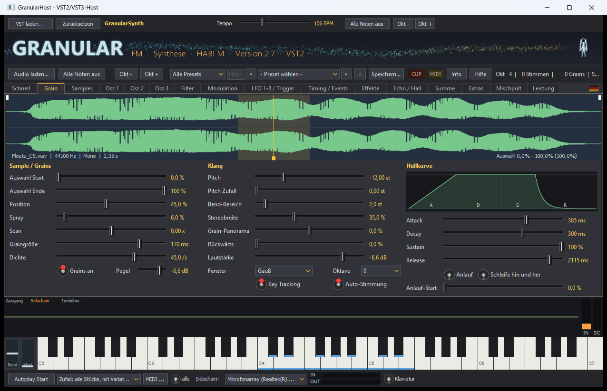

## Ziel

**Professioneller Klang auf dem Niveau kommerzieller Digital-Synthesizer.** Bei jeder Entscheidung gilt die Reihenfolge:
1. **Klangqualität:** saubere Filter (TPT/Zavalishin), bandbegrenzte Oszillatoren (PolyBLEP), Hermite-Interpolation der Grains, 2x-Oversampling für Oszillatoren und Sättigung.
2. **Niedrige Rechenlast:** handoptimierte SSE-Kerne, jeder mit Pascal-Referenz im Prüfstand.
3. **Einfache Bedienung:** eine klare Oberfläche, Hilfe auf Deutsch und Englisch, Lernpfad.

*Goal: professional sound on the level of commercial digital synthesizers. Priorities: 1. sound quality, 2. low CPU load, 3. easy operation.*

## Was er kann

- **Granular-Synthese** aus beliebigen Samples (WAV, MP3 u. a.). Einstellbar sind Auswahl, Position, Spray, Scan, Graingröße, Dichte, Fenster und Rückwärts-Anteil. Dazu kommen ein Anlauf vor dem ersten Sound, eine frei wählbare Hüllkurve, bis zu 32 Grains pro Stimme und zeitlich fein abgestimmte Modulation.
- **Drei FM-Oszillatoren** mit eigener Hüllkurve, eigenem Filter und Unison, auch mit **selbst gezeichneter Welle** oder **geladener Wavetable** (Serum-/Vital-WAV, bis 32 Frames, Position je Note und Zeile im Matrix-Editor).
- **Audio bearbeiten:** Sample direkt im Plugin aufnehmen (Mikrofon oder „was der PC abspielt“), vorhören, zuschneiden, löschen, ein-/ausblenden, normalisieren, Stille entfernen, umkehren und mit einem Satellitensystem bei Wiedergabe nachziehen.
- **Fenstergröße:** 100 bis 200 % für große und hochauflösende Bildschirme.
- **Arp als MIDI:** Das Arp-Muster mit dem gespielten Akkord per Maus als MIDI-Datei in eine Spur der DAW ziehen.
- **Feedback-Resampling:** Solange eine Taste gehalten wird, wird der eigene Klang Durchlauf für Durchlauf (frei oder im Takt) zur neuen Grain-Quelle – er entwickelt sich, je länger man hält.
- **Modulationsmatrix mit 32 Zeilen**, 8 LFOs (auch frei gezeichnet oder als **Step-Sequencer mit Gleiten je Stufe**), zwei freie **Modulations-Hüllkurven**, Velocity, Sidechain-Pegel und Sidechain-Tonhöhe, Ableitungen, Wobbel, Trap, A/B und Makros.
- **Vier freie Makros**: Ein Regler bewegt beliebig viele Ziele mit wählbarer Kurve. Die Makros lassen sich in der DAW automatisieren.
- **Effekte**: zwei Filter, EQ, Echo, Hall, Gate, Crusher, Chorus, Phaser (Reihenfolge wählbar) und Trance-Gate. **Sättigung** in vier Arten (Warm, Röhre, Hart, Faltung), **3-Band-Kompressor** und einfach zu nutzende Master-Module.
- **Sidechain**: Tonhöhe erkennen (Auto-Pitch), Trigger aus Pegel und Ton, Aufnahme.
- **Morph**: zwischen zwei kompletten Klängen überblenden.
- **Oberfläche auf Deutsch oder Englisch**, umschaltbar per Klick auf die Flagge.
- **Bedienung**: MIDI-Learn, Rückgängig/Wiederholen, A/B-Vergleich, Variieren, Preset-Kategorien und Favoriten. Presets lassen sich mit eingebetteten Samples speichern.
- **Mitgeliefert**: über 160 Presets, darunter ein **Lernpfad (L01–L46)**, der die Matrix und alle neuen Funktionen Schritt für Schritt erklärt. Dazu Beispieltöne und eine ausführliche Hilfe.
- **GranularHost**: ein kleiner Test-Host für VST2 und VST3 mit Klaviatur, Autoplay, Audio-Ein- und -Ausgang, Sidechain und einem Prüfstand (`-bench`).

## Alle Reiter

Die Reiter folgen dem Weg des Signals. Klick auf ein Bild zeigt es groß.

| | |
|---|---|
| **Schnell: Makros, Variieren, A/B**<br>[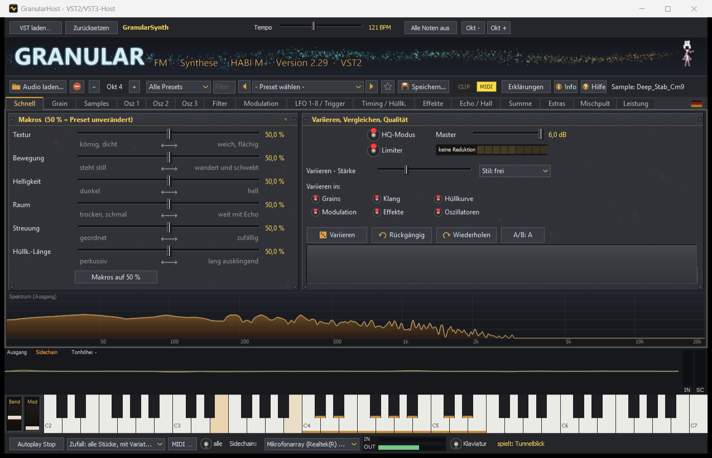](docs/screenshots/schnell.png) | **Grain: Sample, Grains, Hüllkurve**<br>[](docs/screenshots/grain.png) |
| **Samples: Zonen und Aufnahme**<br>[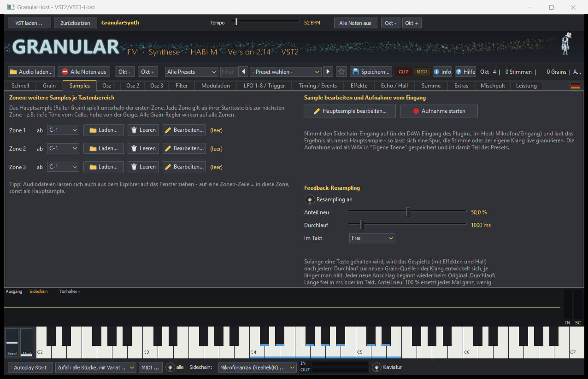](docs/screenshots/samples.png) | **Osz 1-3: FM-Oszillatoren**<br>[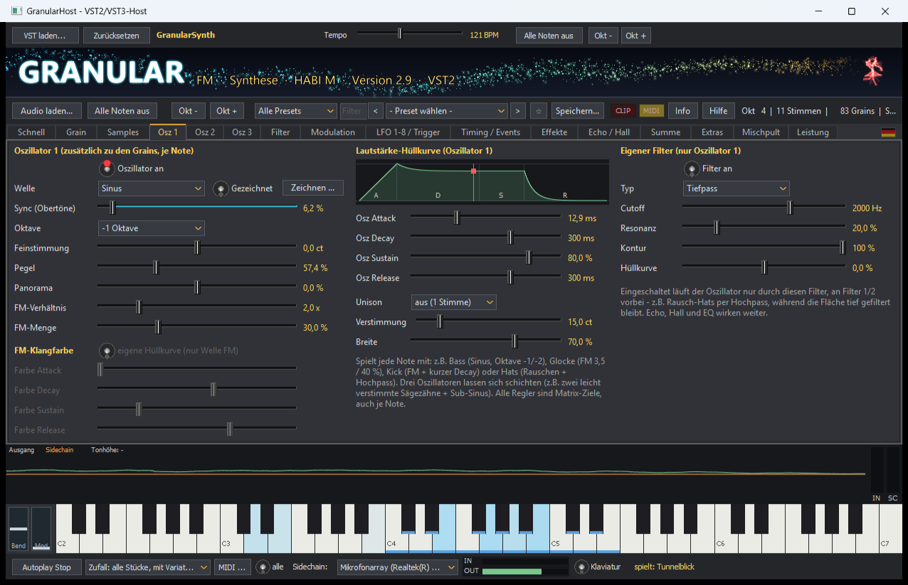](docs/screenshots/osz.png) |
| **Gezeichnete Oszillator-Welle**<br>[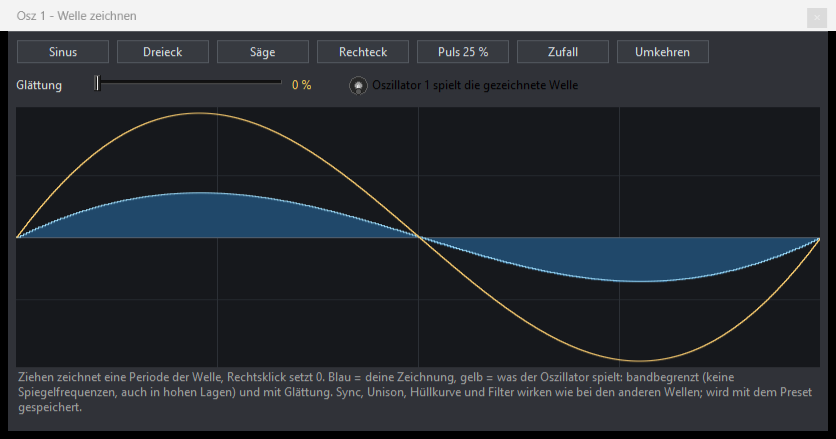](docs/screenshots/osz_welle.png) | **Filter 1 + 2 (je Note)**<br>[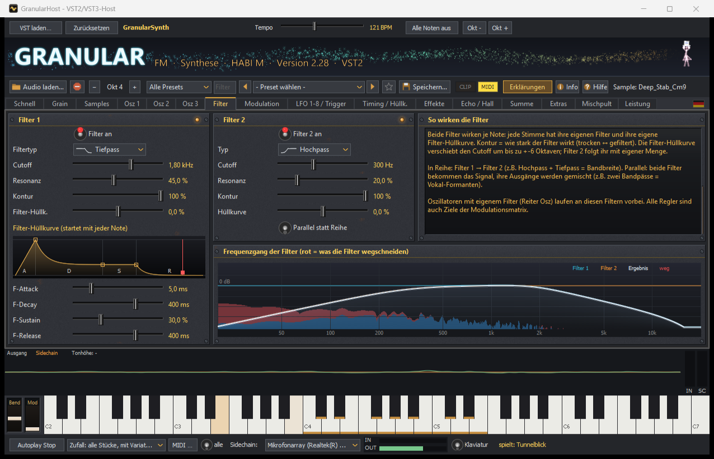](docs/screenshots/filter.png) |
| **Modulationsmatrix und freie Makros**<br>[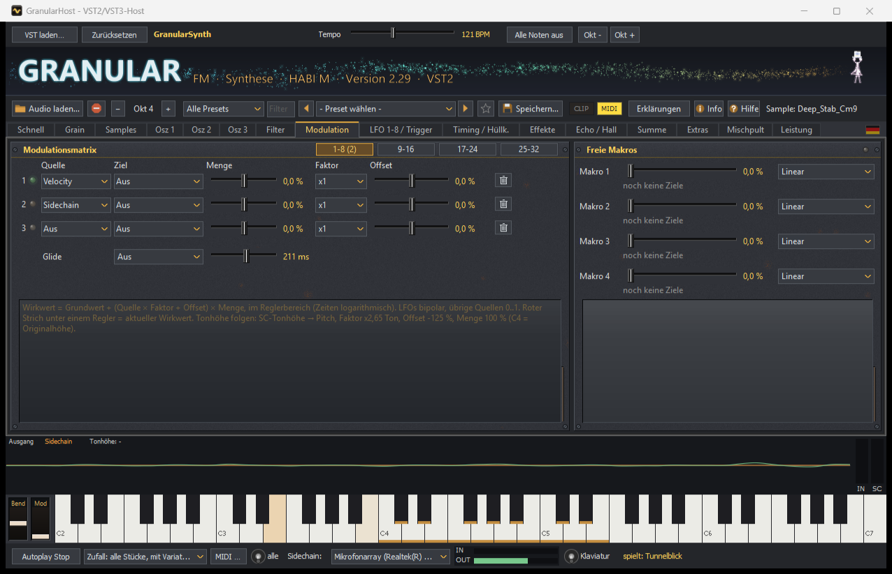](docs/screenshots/modulation.png) | **LFO 1-8 und Trigger**<br>[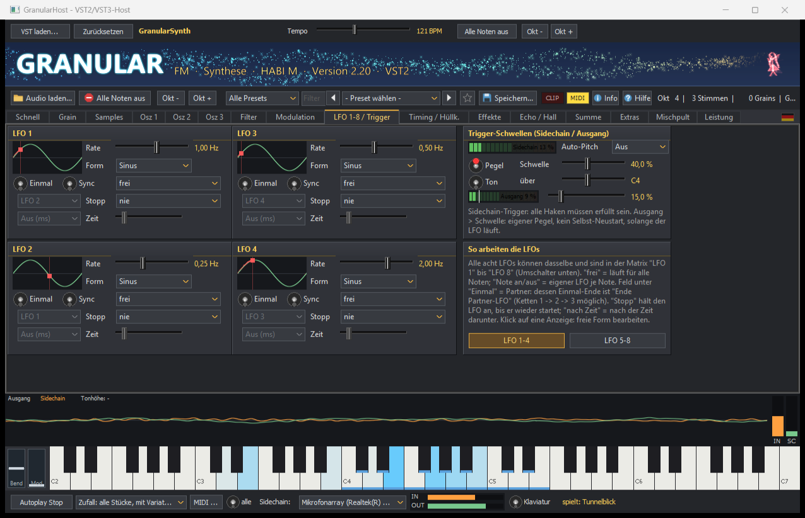](docs/screenshots/lfo.png) |
| **Freier LFO / Step-Sequencer mit Gleiten**<br>[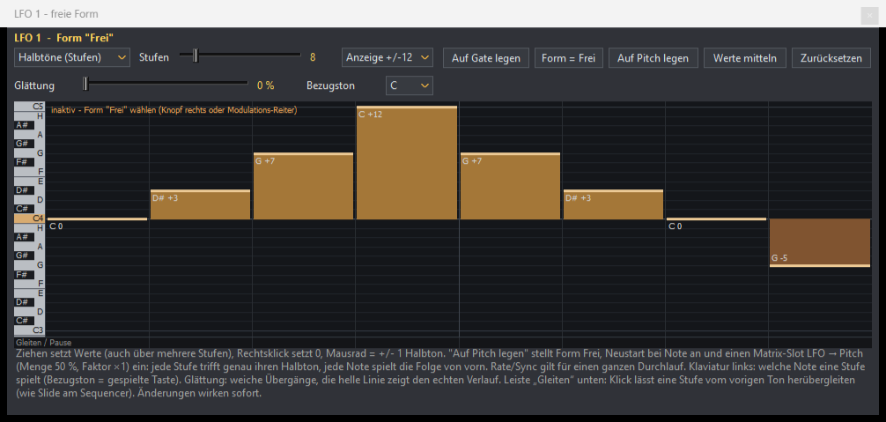](docs/screenshots/lfo_frei.png) | **Timing / Modulations-Hüllkurven**<br>[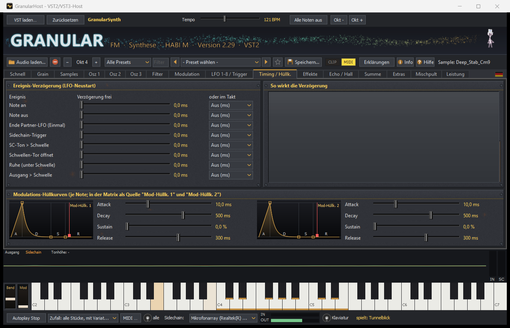](docs/screenshots/timing.png) |
| **Effekte: Chorus, Phaser, Crusher, Trance-Gate**<br>[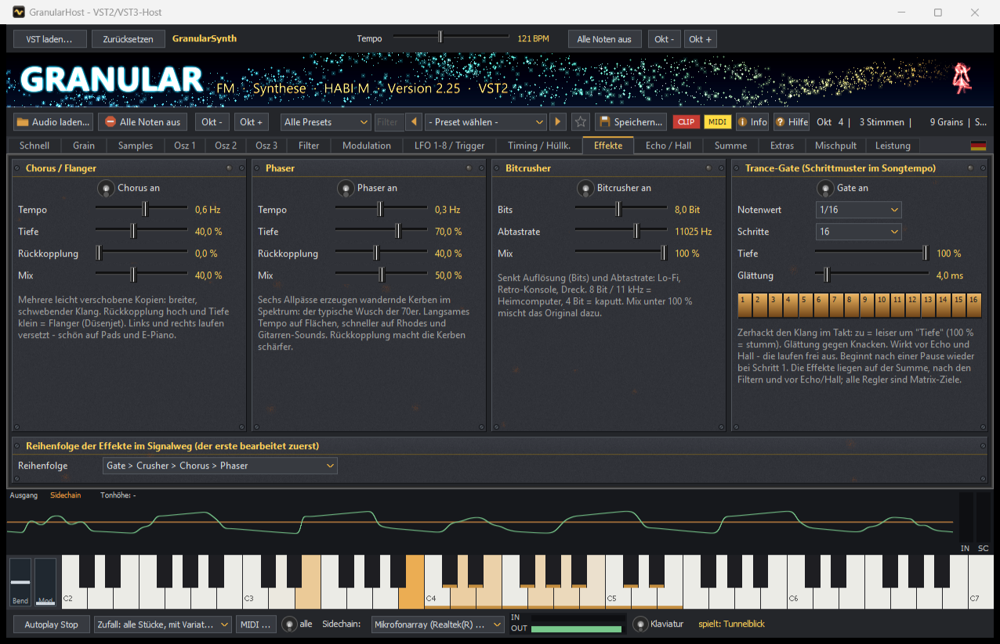](docs/screenshots/effekte.png) | **Echo / Hall**<br>[](docs/screenshots/echo.png) |
| **Summe: EQ, Kompressor, Sättigung, Stereo, Limiter**<br>[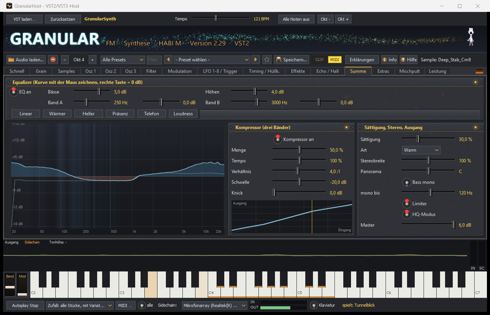](docs/screenshots/summe.png) | **Extras: Arpeggiator, Sprache, Hyper-Modulation**<br>[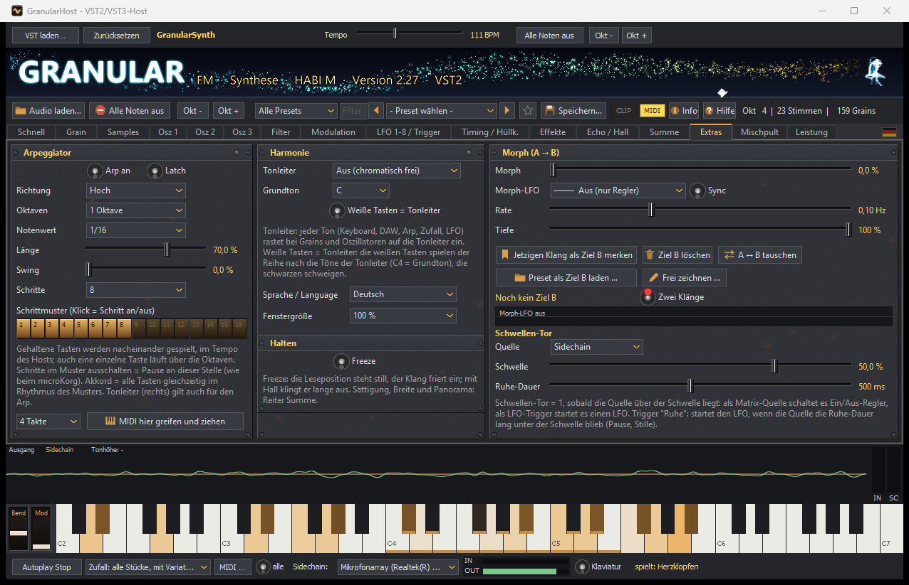](docs/screenshots/extras.png) |
| **Mischpult**<br>[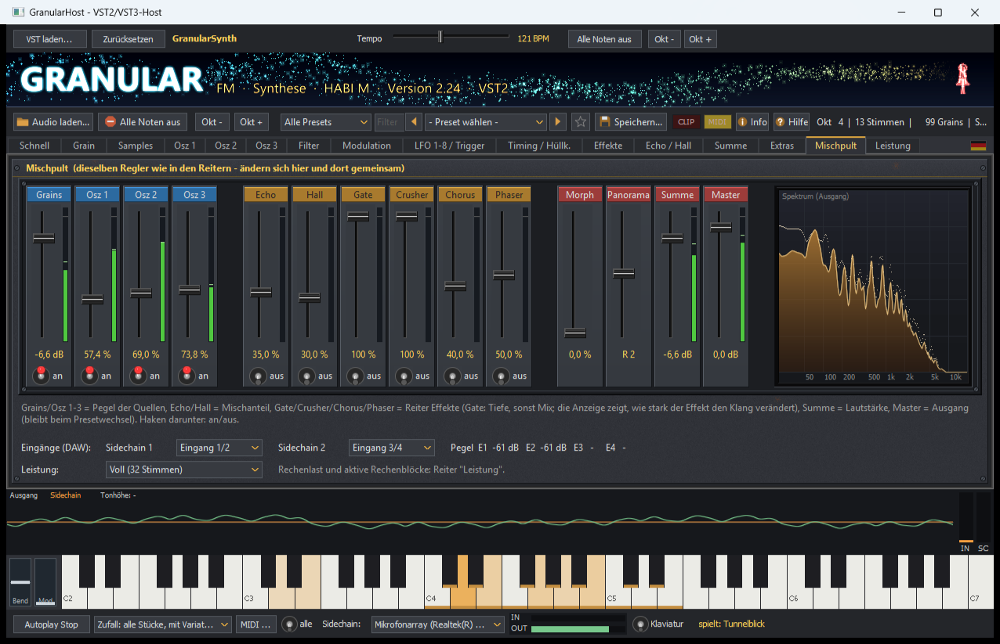](docs/screenshots/mischpult.png) | **Leistung: Rechenlast, Oversampling**<br>[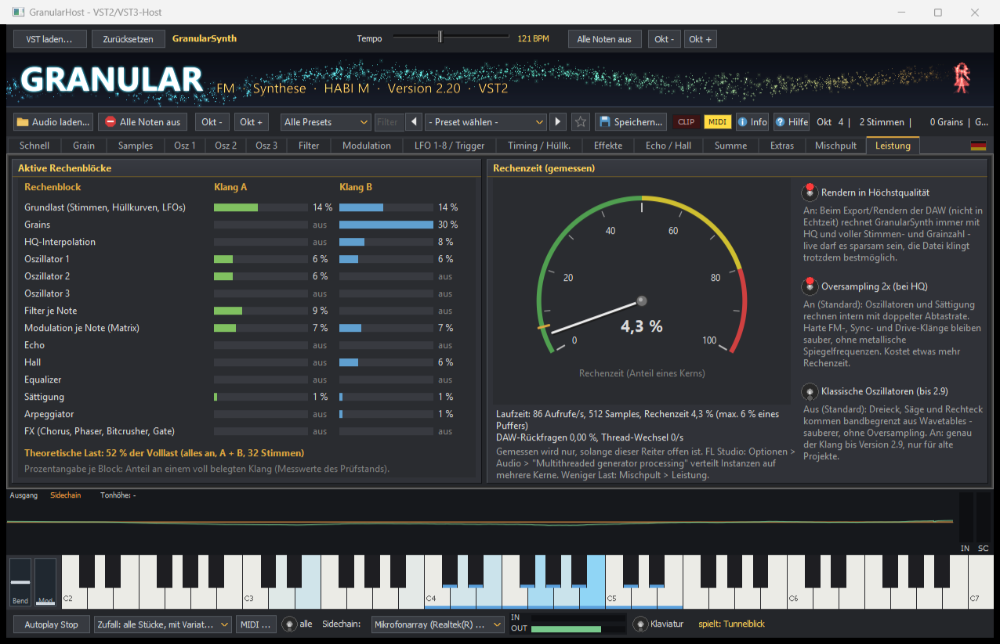](docs/screenshots/leistung.png) |
| **Audio bearbeiten: Aufnahme, Vorhören, Schnitt**<br>[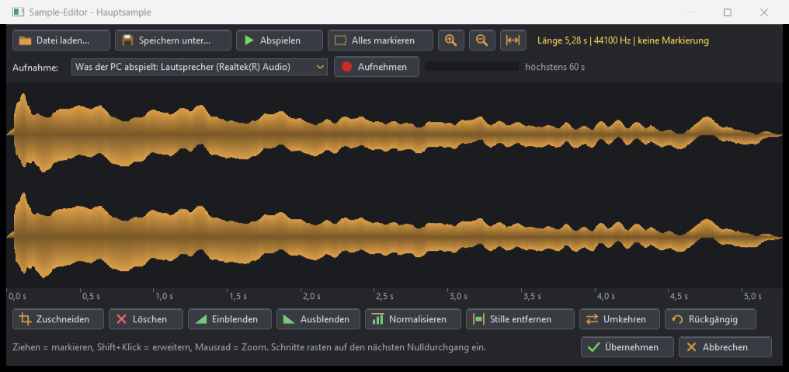](docs/screenshots/audio_bearbeiten.png) | |

*English interface / englische Oberfläche:*

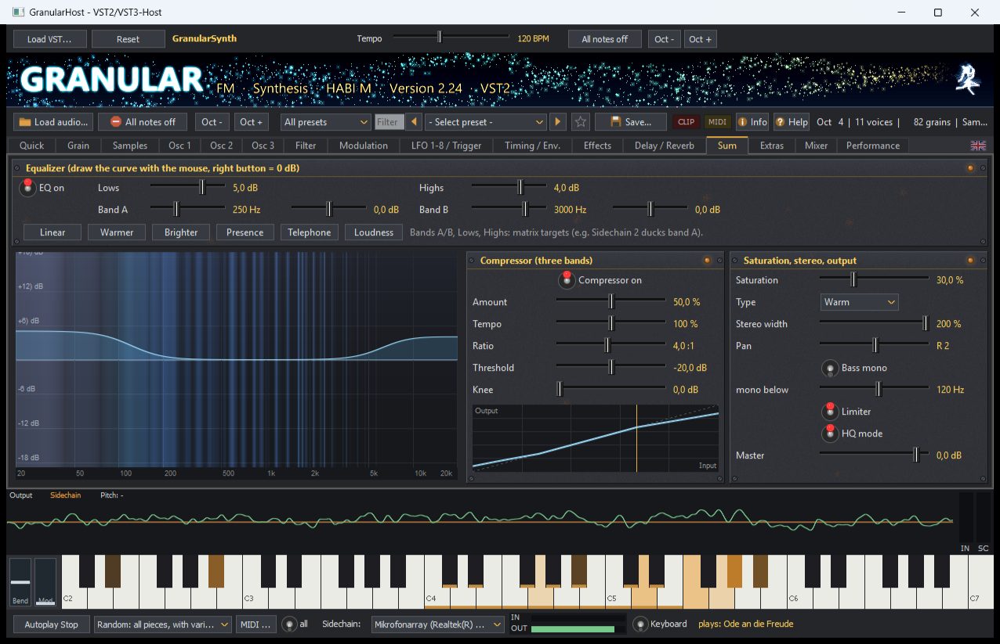

## Installation

1. Lade die aktuelle Version unter **[Releases](../../releases)** herunter und entpacke sie.
2. Starte `Setup.exe`. Wähle 64 oder 32 Bit (passend zur DAW), VST2 und/oder VST3 und auf Wunsch den Test-Host.
3. Lass die DAW neu nach Plugins suchen.

Entfernen lässt sich GranularSynth über *Windows-Einstellungen › Apps*.
Mehr dazu steht in [LIESMICH.txt](LIESMICH.txt), die Änderungen je Version stehen in [CHANGELOG.md](CHANGELOG.md).

## Selbst bauen

Voraussetzungen:
- Embarcadero Delphi 12 (RAD Studio 23.0). Die kostenlose **[Delphi Community Edition](https://www.embarcadero.com/products/delphi/starter)** reicht aus: GranularSynth braucht nur VCL und die Win32/Win64-API.
- optional [FastMM5](https://github.com/pleriche/FastMM5): Ordner in `FASTMM_DIR` (wie `GR32_DIR`). Ohne bleibt der Speichermanager von Delphi; gemessen bringt FastMM5 hier keinen Vorteil.
- **[Graphics32](https://github.com/graphics32/graphics32)** – aktuelle stabile Referenz: **1.9.1**. Für die aktuelle Entwicklung kann auch der `master`-Branch verwendet werden. Der Ordner wird in der Umgebungsvariablen `GR32_DIR` eingetragen, am einfachsten in einer Datei `build.local.bat` neben `build.bat`:
  ```bat
  @set GR32_DIR=C:\Komponenten\Graphics32
  ```
  Wer in der Delphi-IDE baut, legt `GR32_DIR` unter *Tools › Optionen › Umgebungsvariablen* an.
- Python 3, nur für die Werkzeuge in `Tools/`

```bat
build.bat Release Win64 Alle
build.bat Release Win32 Alle
bin\Win64\GranularHost.exe -bench
deploy.bat
```

- `build.bat` baut für beide Plattformen.
- Der Prüfstand `-bench` schreibt seine Ergebnisse nach `bin\<Plattform>\bench.txt`.
- `deploy.bat` legt die Auslieferung nach `Deploy\`.

Aufbau, Regeln und Werkzeuge stehen in [CLAUDE.md](CLAUDE.md). Diese Datei ist für Entwickler und für KI-Assistenten gedacht.

## Mitmachen

Fehlermeldungen und Feature-Wünsche sind willkommen: bitte über **[Issues](../../issues)** mit den Vorlagen dort oder im [Forum-Thread auf KVR](https://www.kvraudio.com/product/granularsynth-by-matthias-haberecht). 
Gefällt dir GranularSynth? Eine kurze Bewertung auf **[KVR Audio](https://www.kvraudio.com/product/granularsynth-by-matthias-haberecht)** hilft anderen, es zu finden.
Wenn du Code beitragen möchtest, frag bitte vorher in einem Issue an. Die Regeln stehen in [CONTRIBUTING.md](CONTRIBUTING.md).

## Lizenz

Copyright © 2026 Matthias Haberecht.
GranularSynth ist freie Software unter der **GNU General Public License Version 3 oder neuer** (siehe [LICENSE.txt](LICENSE.txt)). Du darfst sie nutzen, weitergeben und verändern. Veränderte Fassungen müssen ebenfalls unter der GPL stehen.

VST ist eine Marke der Steinberg Media Technologies GmbH. Die VST-Schnittstellen sind hier eigenständig aus der öffentlichen Spezifikation umgesetzt.
