# GranularSynth

*[Deutsche Version](README.md)*

**Granular and FM synthesizer as a VST2 and VST3 plugin for Windows (32 and 64 bit)**, with its own test host.
Written in Delphi, without a plugin framework. The CPU-heavy parts are hand-optimized in SSE assembler to keep the CPU load low.

The user interface and the help are available in **English and German** – switch with a click on the small flag in the tab row (or Extras tab › "Sprache / Language").

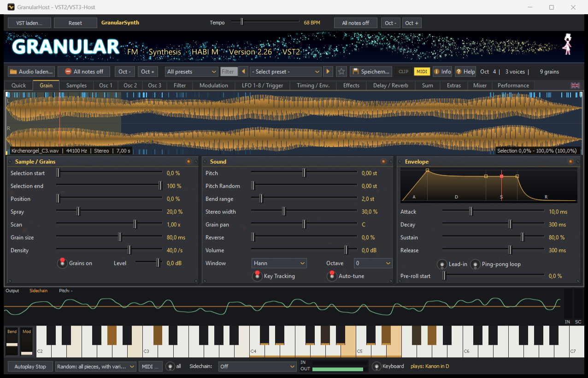

## Goal

**Professional sound on the level of commercial digital synthesizers.** Every decision follows this order:
1. **Sound quality:** clean filters (TPT/Zavalishin), band-limited oscillators (PolyBLEP), Hermite interpolation for the grains, 2x oversampling for oscillators and saturation.
2. **Low CPU load:** hand-optimized SSE kernels, each with a Pascal reference in the test bench.
3. **Easy operation:** a clear interface, help in English and German, a learning path.

## Features

- **Granular synthesis** from any sample (WAV, MP3 and more). Selection, position, spray, scan, grain size, density, window and reverse amount are adjustable, plus a run-up before the selection, a back-and-forth loop and up to three zones.
- **Three FM oscillators** with their own envelope, filter and unison, also with a **hand-drawn wave** or a **loaded wavetable** (Serum/Vital WAV, up to 32 frames, position modulatable per note). Plus a **sub oscillator and noise** on Osc 1. In HQ mode, oscillators and saturation run with **2x oversampling**: even hard FM and drive sounds stay free of aliasing.
- **Audio editing:** record a sample directly in the plugin (microphone or "what the PC plays"), preview, trim, delete, fade in/out, normalize, remove silence, reverse – cuts snap to zero crossings. Save as WAV or MP3.
- **Window size:** 100 to 200 % for large and high-resolution screens.
- **Arp as MIDI:** drag the arp pattern with the played chord as a MIDI file into a DAW track.
- **Feedback resampling:** while a key is held, the plugin's own sound becomes the new grain source pass by pass (free or in time) – it evolves the longer you hold.
- **Modulation matrix with 32 rows**, 8 LFOs (also hand-drawn or as a **step sequencer with per-step glide and rests**), two free **modulation envelopes**, velocity, sidechain level and sidechain pitch. Modulation works per note.
- **Four free macros**: one knob moves any number of targets with a selectable curve. Macros can be automated in the DAW.
- **Effects**: two filters (with a live response display), EQ, echo, reverb, gate, crusher, chorus, phaser (selectable order) and trance gate. **Saturation** in four types (warm, tube, hard, fold), **3-band compressor** in OTT style with ratio, threshold, knee and transfer curve, **bass mono**. Plus a mixer in console style with level meters.
- **Sidechain**: pitch detection (auto pitch), triggers from level and pitch, recording.
- **Morph**: crossfade between two complete sounds.
- **Workflow**: MIDI learn, undo/redo, A/B compare, randomize, preset categories and favorites. Presets can be saved with embedded samples.
- **Included**: more than 160 presets, among them a **learning path (L01–L46)** that explains the matrix and all features step by step. Plus example sounds and detailed help.
- **GranularHost**: a small test host for VST2 and VST3 with keyboard, autoplay, audio in/out, sidechain and a test bench (`-bench`).

## All tabs

The tabs follow the signal path. Click an image to enlarge it.
*The screenshots may show an older version where the interface has hardly changed since.*

| | |
|---|---|
| **Quick: macros, randomize, A/B**<br>[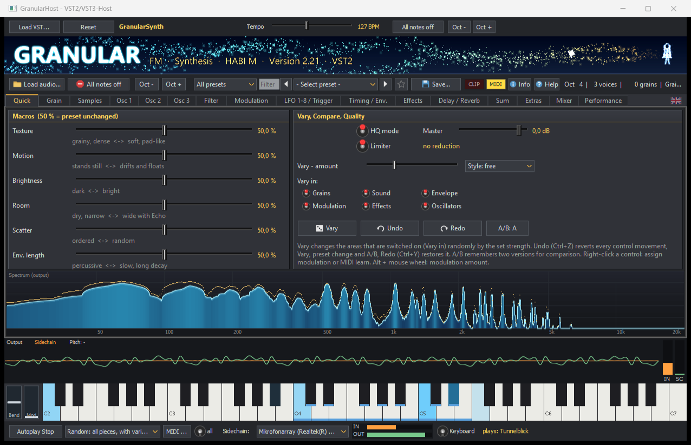](docs/screenshots/en/quick.png) | **Grain: sample, grains, envelope**<br>[](docs/screenshots/en/grain.png) |
| **Samples: zones and recording**<br>[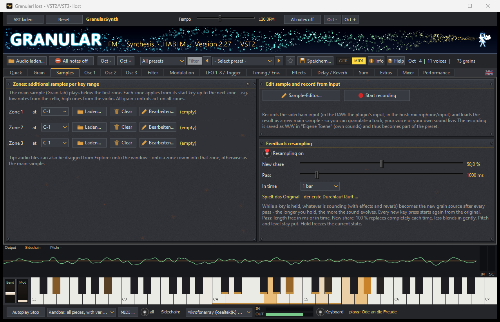](docs/screenshots/en/samples.png) | **Osc 1-3: FM oscillators**<br>[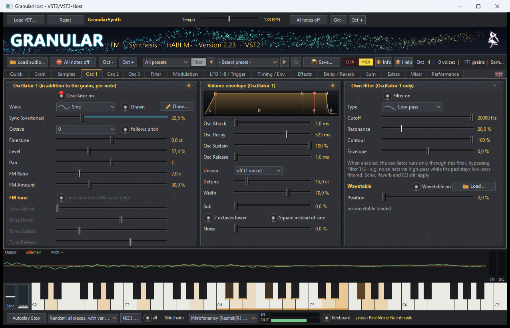](docs/screenshots/en/osc.png) |
| **Filter 1 + 2 (per note) with response display**<br>[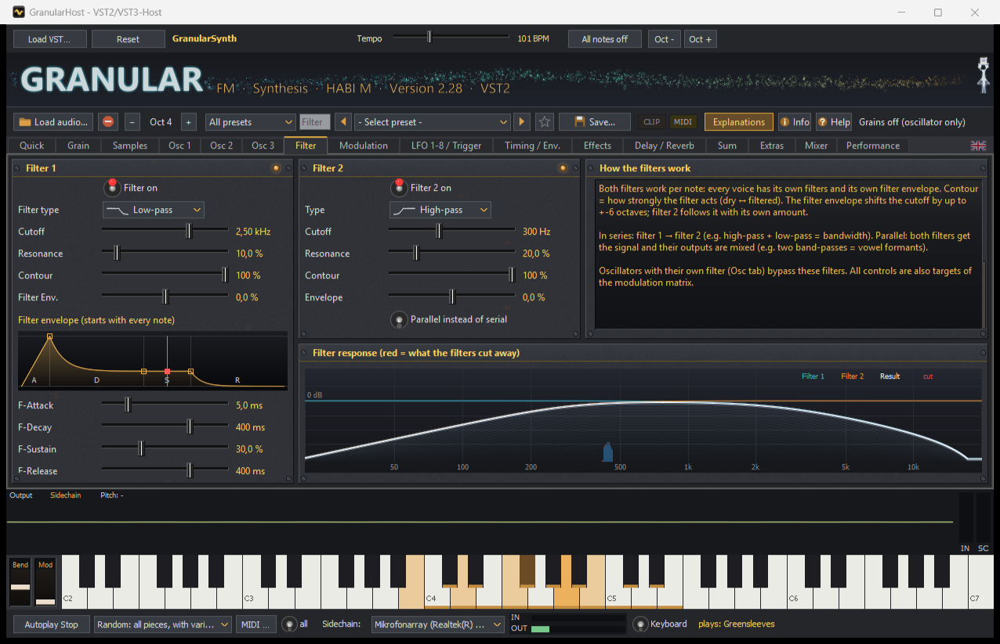](docs/screenshots/en/filter.png) | **Modulation matrix and free macros**<br>[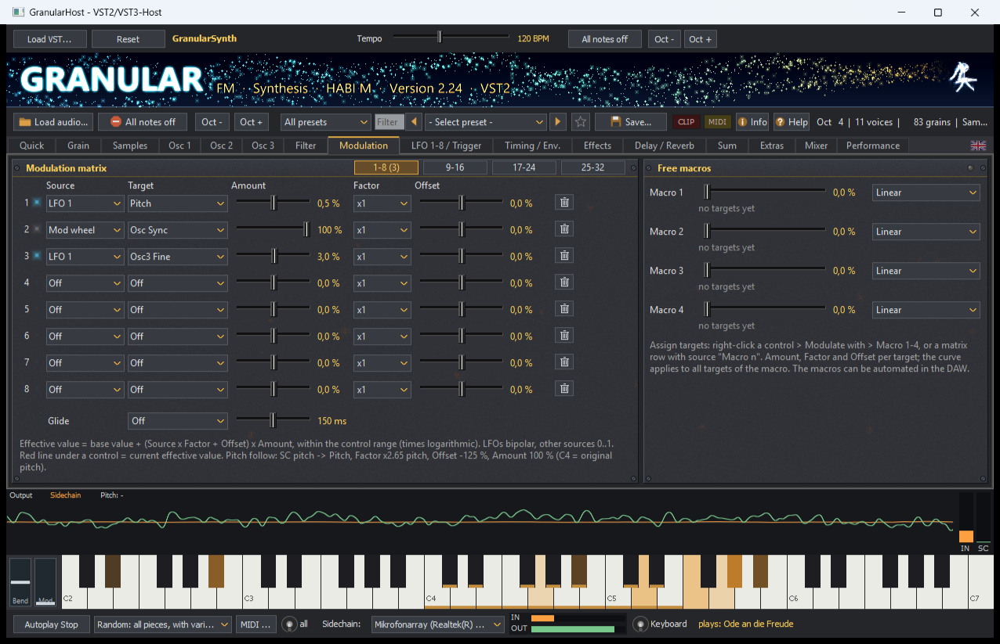](docs/screenshots/en/modulation.png) |
| **LFO 1-8 and triggers**<br>[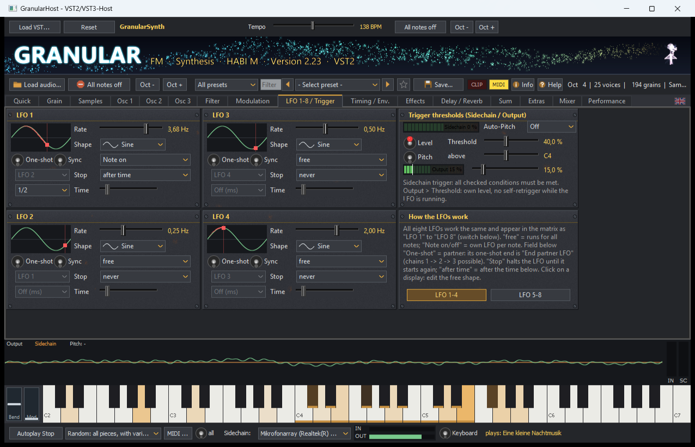](docs/screenshots/en/lfo.png) | **Timing / modulation envelopes**<br>[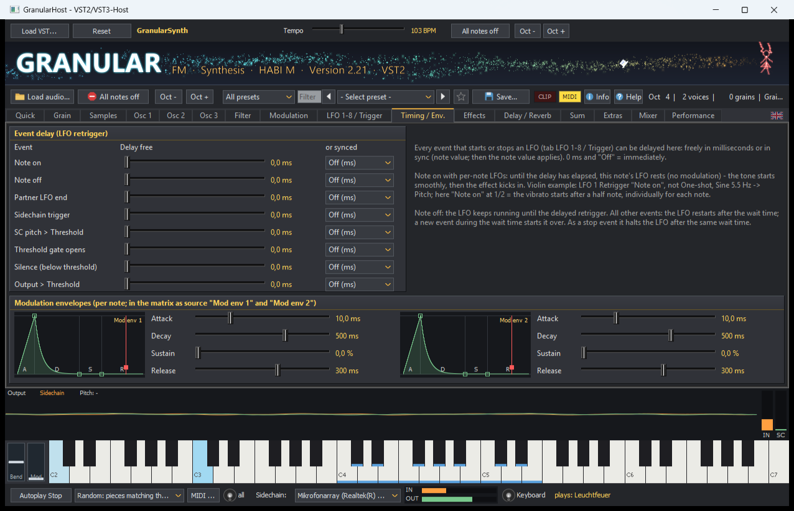](docs/screenshots/en/timing.png) |
| **Effects: chorus, phaser, crusher, trance gate**<br>[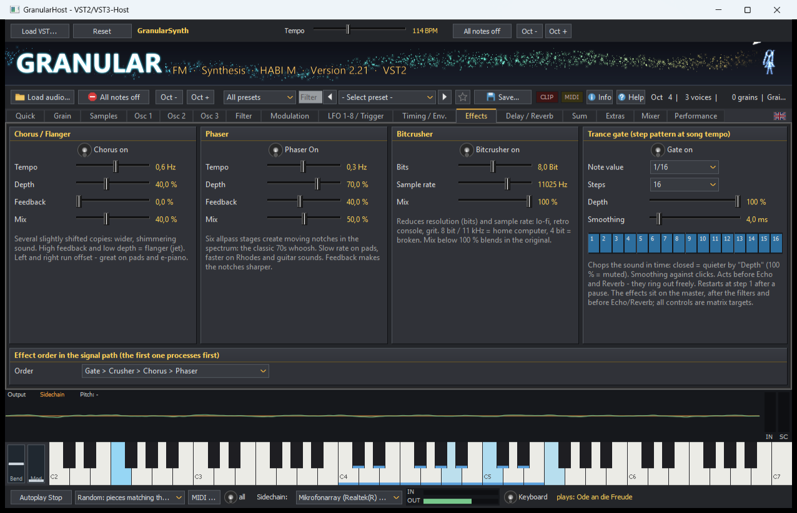](docs/screenshots/en/effects.png) | **Echo / reverb**<br>[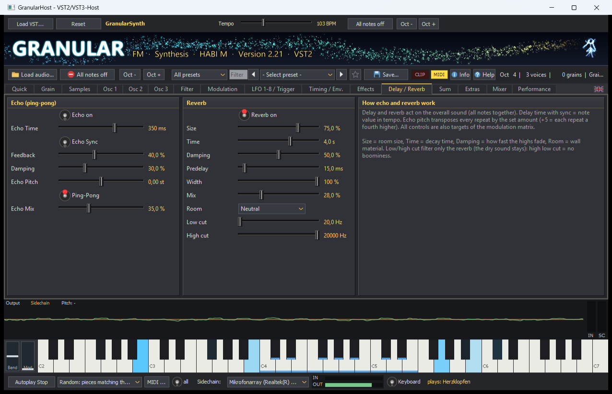](docs/screenshots/en/echo_reverb.png) |
| **Sum (master): EQ, compressor, saturation, stereo, limiter**<br>[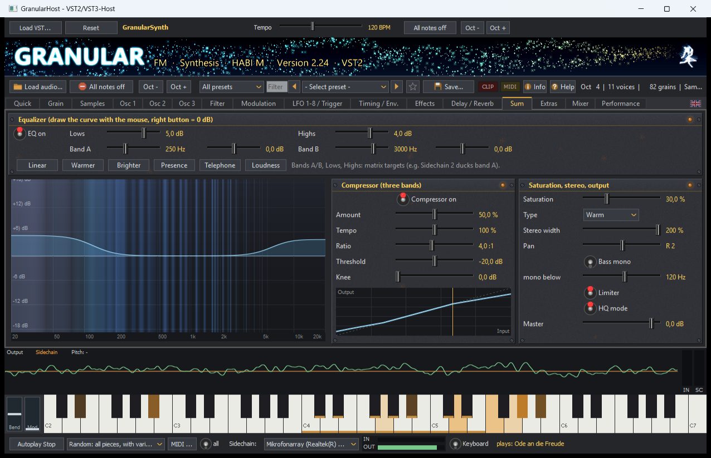](docs/screenshots/en/master.png) | **Extras: arpeggiator, harmony, morph**<br>[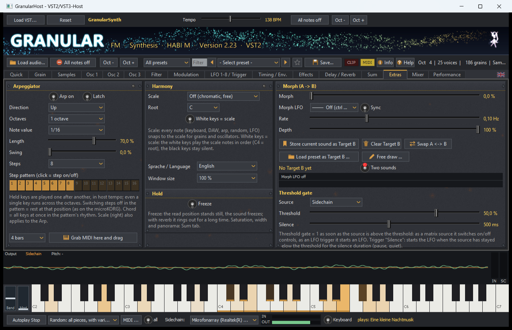](docs/screenshots/en/extras.png) |
| **Mixer**<br>[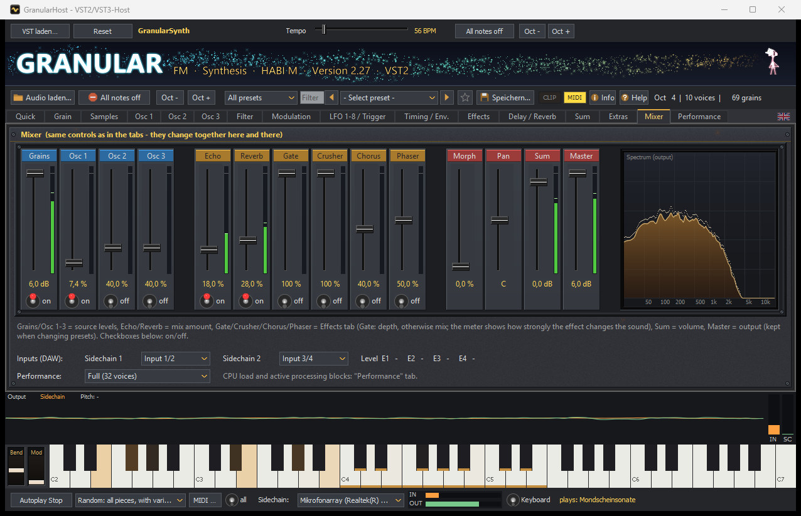](docs/screenshots/en/mixer.png) | **Performance: CPU load, oversampling**<br>[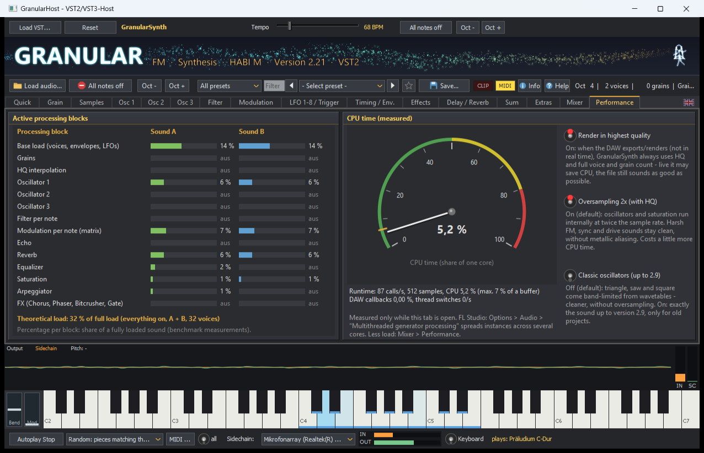](docs/screenshots/en/performance.png) |

## Installation

1. Download the latest version from **[Releases](../../releases)** and unzip it.
2. Run `Setup.exe`. Choose 64 or 32 bit (matching your DAW), VST2 and/or VST3 and optionally the test host.
3. Let your DAW rescan for plugins.

GranularSynth can be removed via *Windows Settings › Apps*.
More in [README_EN.txt](README_EN.txt); the changes per version are in [CHANGELOG.md](CHANGELOG.md) (German).

**Linux (untested):** GranularSynth is a Windows plugin. On Linux it should work via [VST Environment (vstenv)](https://github.com/dguedry/vstenv), which sets up Wine and yabridge and makes Windows plugins available to REAPER, Bitwig, Ardour and others. Use the **64-bit** version only (VST3 or VST2); `Setup.exe` can be installed directly through it. Reports are welcome as an issue.

## Building it yourself

Requirements:
- Embarcadero Delphi 12 (RAD Studio 23.0). The free **[Delphi Community Edition](https://www.embarcadero.com/products/delphi/starter)** is enough: GranularSynth only needs the VCL and the Win32/Win64 compilers, no extra packages. The Community Edition is meant for hobbyists and small projects (Embarcadero license, revenue limit among others, renewed yearly). It has no command-line compilers; open `GranularSynth.dproj` and `GranularHost.dproj` in the IDE and build there (Release, Win32 and Win64) instead of using `build.bat`.
- optional [FastMM5](https://github.com/pleriche/FastMM5): folder in `FASTMM_DIR` (like `GR32_DIR`). Without it, Delphi's memory manager is used; measured, FastMM5 brings no advantage here.
- [Graphics32](https://github.com/graphics32/graphics32), stable version **1.9.1** (the `master` branch works too). Put its folder into the environment variable `GR32_DIR`, easiest in a file `build.local.bat` next to `build.bat`:
  ```bat
  @set GR32_DIR=C:\Components\Graphics32
  ```
  When building in the Delphi IDE, add `GR32_DIR` under *Tools › Options › Environment Variables*.
- Python 3, only for the tools in `Tools/`

```bat
build.bat Release Win64 Alle
build.bat Release Win32 Alle
bin\Win64\GranularHost.exe -bench
deploy.bat
```

- `build.bat` builds for both platforms.
- The test bench `-bench` writes its results to `bin\<platform>\bench.txt`.
- `deploy.bat` puts the release into `Deploy\`.

Structure, rules and tools are described in [CLAUDE.md](CLAUDE.md) (German), meant for developers and AI assistants.

## Contributing

Bug reports and feature requests are welcome: please use **[Issues](../../issues)** with the templates there, or the [KVR forum thread](https://www.kvraudio.com/product/granularsynth-by-matthias-haberecht).
Like GranularSynth? A short rating on **[KVR Audio](https://www.kvraudio.com/product/granularsynth-by-matthias-haberecht)** helps others find it.
If you want to contribute code, please ask in an issue first. The rules are in [CONTRIBUTING.md](CONTRIBUTING.md).

## License

Copyright © 2026 Matthias Haberecht.
GranularSynth is free software under the **GNU General Public License version 3 or later** (see [LICENSE.txt](LICENSE.txt)). You may use, share and modify it. Modified versions must also be under the GPL and refer to the original.

VST is a trademark of Steinberg Media Technologies GmbH. The VST interfaces are implemented independently from the public specification.
